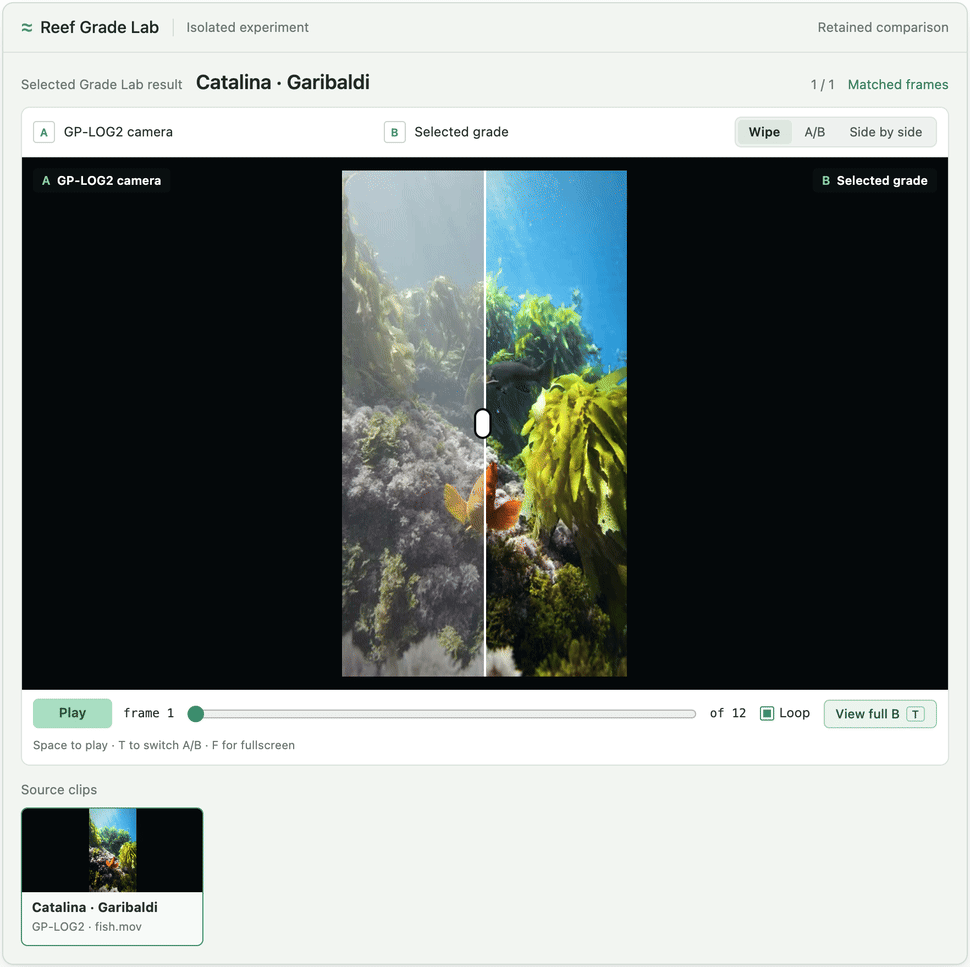
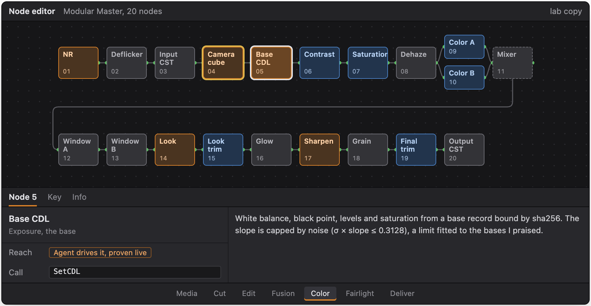
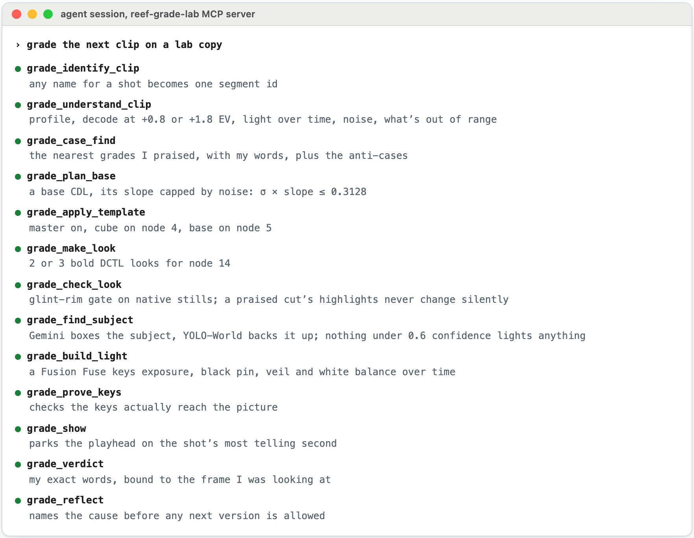
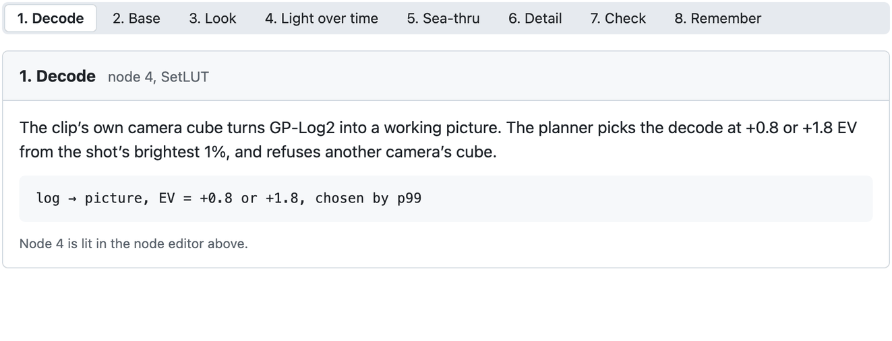
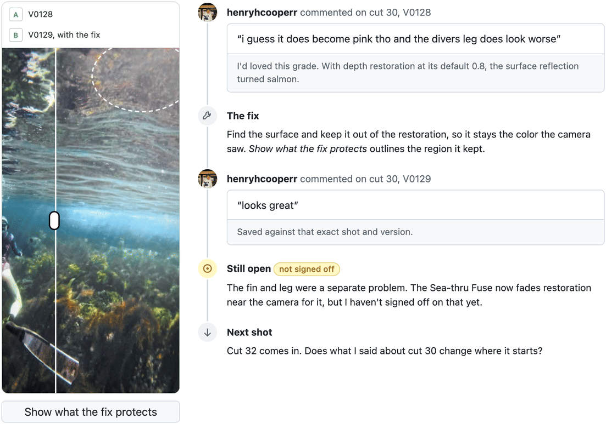
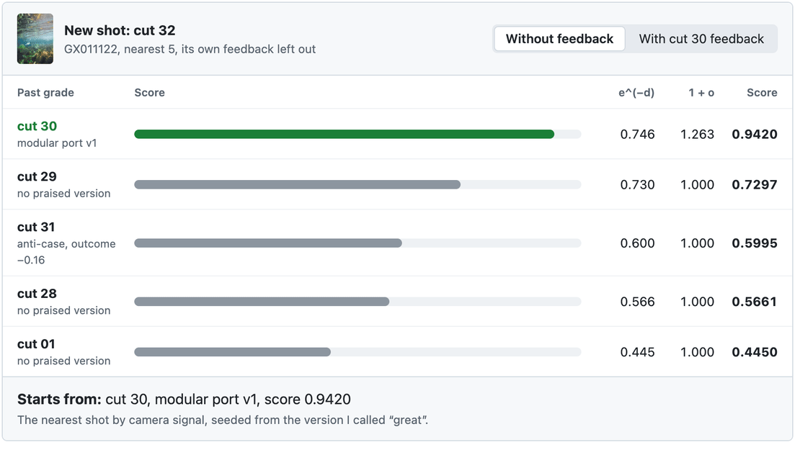
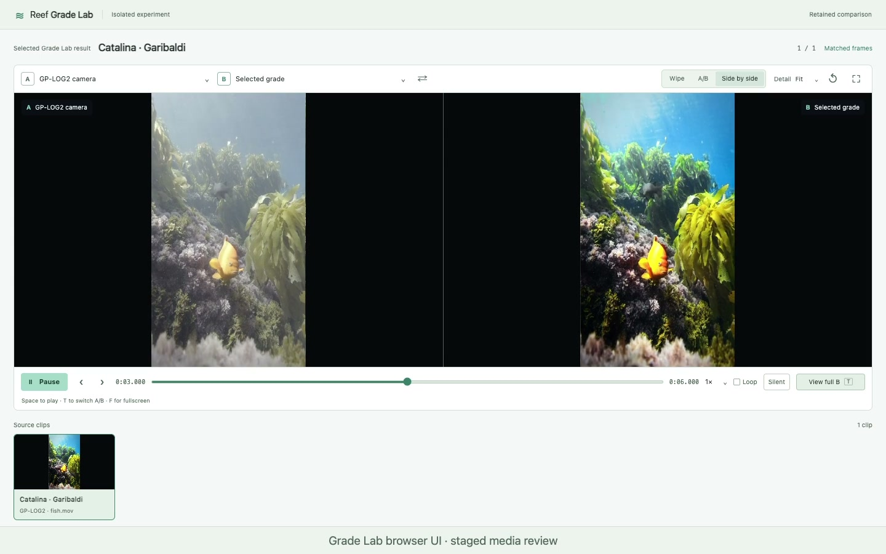

# Reef Grade Lab

**Underwater color that remembers what I said.** GoPro log footage goes in. An agent grades it inside DaVinci Resolve itself, through an MCP server I wrote, on real Resolve nodes I can open and keep editing. Every word of feedback I give is saved, so the next shot starts from a grade I already loved.

Built with Python and NumPy, an MCP server of 116 tools over DaVinci Resolve 21.1's scripting API, DCTL, Fusion Fuses and ResolveFX (UltraNR, UltraSharpen, Dehaze, Depth Map), Gemini with a local YOLO-World backup, and GoPro GP-Log2 footage with its telemetry.

A rebuild of Grade Lab's review page, the one I grade in, not a screen capture. The frames are real: twelve from the Garibaldi shot at Catalina, camera log on A and my grade on B. Here it plays as a loop. A screenshot of the real page is at the end.

## It grades inside DaVinci Resolve

Exporting a LUT would have been easier. I wanted the agent working on the same node graph I'd grade by hand, so I can open any version in Resolve and keep going. Every clip gets the same 20-node master, and each node has one job. Click one to see what the agent can reach.

The agent drives it, proven live in Resolve. A CDL slot the tools allow, not probed yet. Built by hand, left alone.

A rebuild of Resolve's Color page node editor, not a screen capture. The 20 nodes, their order and what the agent can reach come from the Grade Lab master and its tools.

### What the scripting API can't reach

For color, Resolve's scripting API can apply a saved grade, set a CDL, load a LUT and switch nodes on and off. That's about it. Everything else needed a way around.

| The API can't | So Grade Lab |
| --- | --- |
| Add or wire nodes, or a parallel mixer | Builds the 20-node master once, by hand, saves it as a native PowerGrade with a DRP backup, and applies it to each clip as a DRX still |
| Add a creative look | Writes each look as a DCTL program, because `SetLUT` accepts one, and loads it on node 14 |
| Set an effect's strength | Keeps a pinned DRX still for each UltraSharpen amount, and edits saved grades offline for the rest |
| Draw a window or qualifier | Leaves them to me, authored by hand in the master |

The offline edits are byte-exact. One changed 9 bytes of a 1,162-byte grade and left every other byte identical, and UltraSharpen, UltraNR and Dehaze transplant from donor grades with their settings intact. Each edit is proven in Resolve itself: import into a fresh lab project, save, reopen, render native 16-bit frames. On the Dehaze transplant, the reopened pixels matched exactly.

## The agent's walk, one clip

The MCP server gives an agent like Claude 116 tools and one route through them. Each tool's reply says what comes next, and each record it writes is bound by sha256, so nothing gets hand-edited along the way.

A rebuild of one clip's walk as it reads in an agent session, not a captured log. Tool names are the MCP server's own; the line under each says what that tool returns.

> [!IMPORTANT]
> **Guardrails.** Never on my own project, only lab copies. A DRP backup before the first change. Stop at the first crash. A passed check is not approval; only my words are.

## The whole grade, in order

Eight stages, from the camera's log to my verdict. The loop steps through them; each one runs on its own nodes in the editor above.

## It learns from what I say

The frames are real renders of cut 30. The quotes are my exact words from the Grade Lab ledger, retold as a timeline.

Those words are saved against that exact shot and version. When a new shot comes in, Grade Lab ranks past grades by how alike the camera signal looks, then lifts the ones I praised. The loop switches my feedback off and on; watch where cut 32 starts.

Score = e^(−d) × (1 + max(0, o)). d is the distance between two shots' camera fingerprints over 17 keys; o is the outcome of my feedback on that version, which fades with a 21-day half-life. A recorded replay of the real ledger, fixed to Oct 10, 2:26 PM. Shot 31 keeps the same starting point either way, which is part of the result.

## Inside

- An MCP server (Python) with 116 tools that drives DaVinci Resolve 21.1 through its scripting API
- An offline editor for Resolve's saved grade format: byte-exact parameter edits and ResolveFX transplants, proven by save, reopen and native 16-bit renders
- A 20-node Modular Master, DCTL looks for node 14, and a Fusion Fuse for light that moves over time
- Depth-aware Sea-thru restoration on Resolve's Depth Map, opt-in for the shots that deserve it
- Subject metering with Gemini stills and a local YOLO-World backup, inside a spend cap
- Case memory: every version, verdict and quote bound to its shot
- Python and NumPy color math, baked into 65³ LUTs

## Notes

The memory picks where a new grade starts. It is case-based retrieval, not a trained model, and a better starting point is not automatically a better final image. The source is private while I build it; the color transform and case-memory scorer ship as runnable examples in [reef-algorithm-studies](https://github.com/henryhcooperr/reef-algorithm-studies).

## The real review page

The real review page, a screenshot, for comparison with the rebuild.

## Related

- [henryhcooperr profile](https://github.com/henryhcooperr)
- [reef, the editor this grades for](https://github.com/henryhcooperr/reef)
- [reef-algorithm-studies](https://github.com/henryhcooperr/reef-algorithm-studies)
